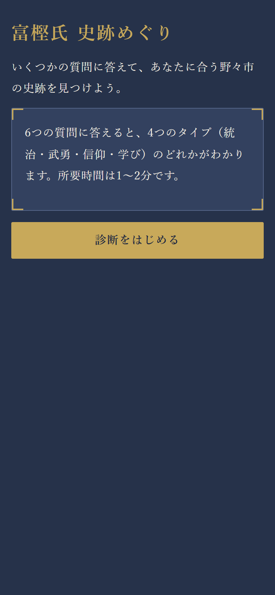
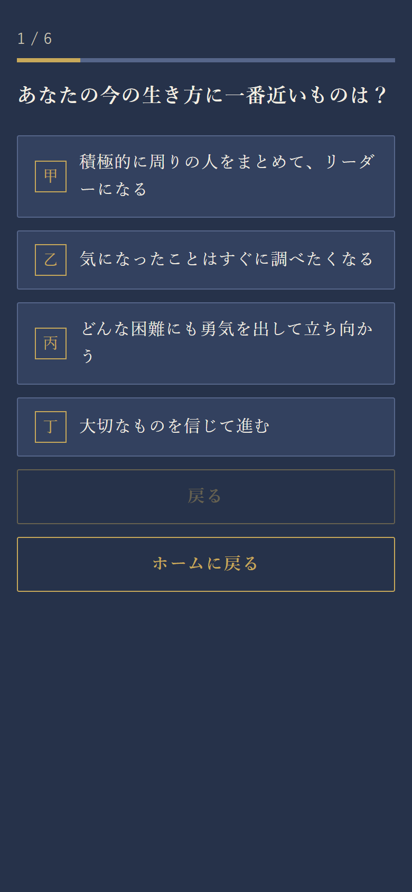
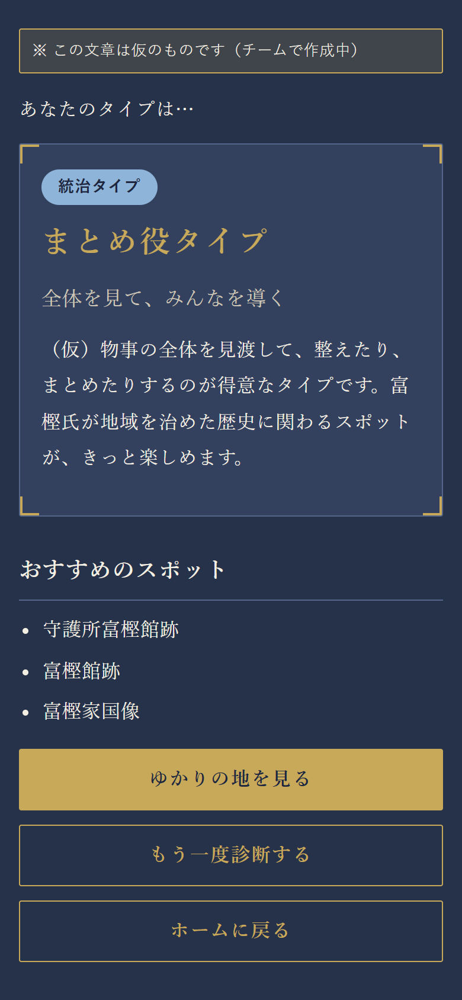
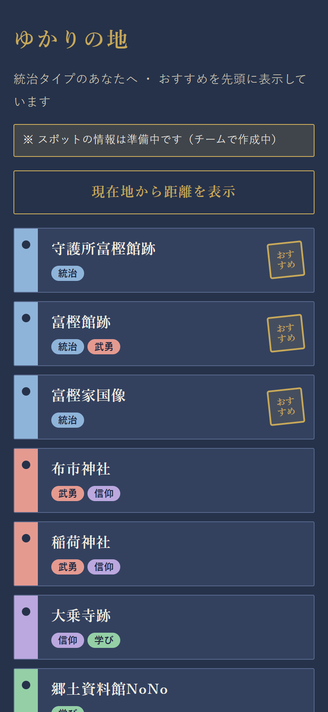
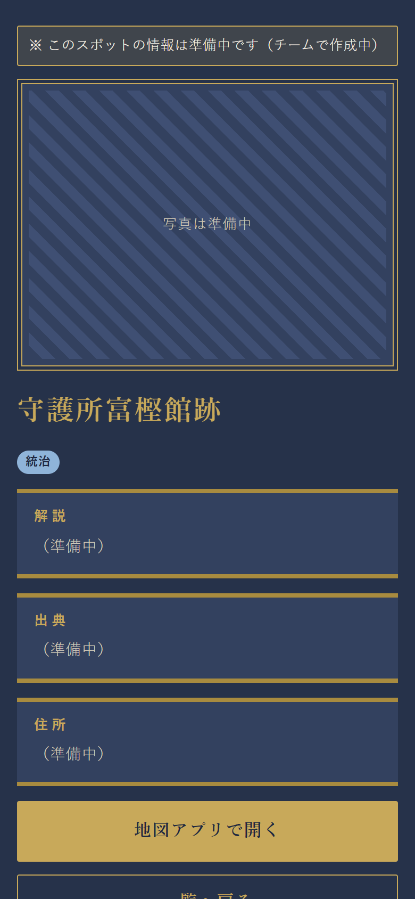
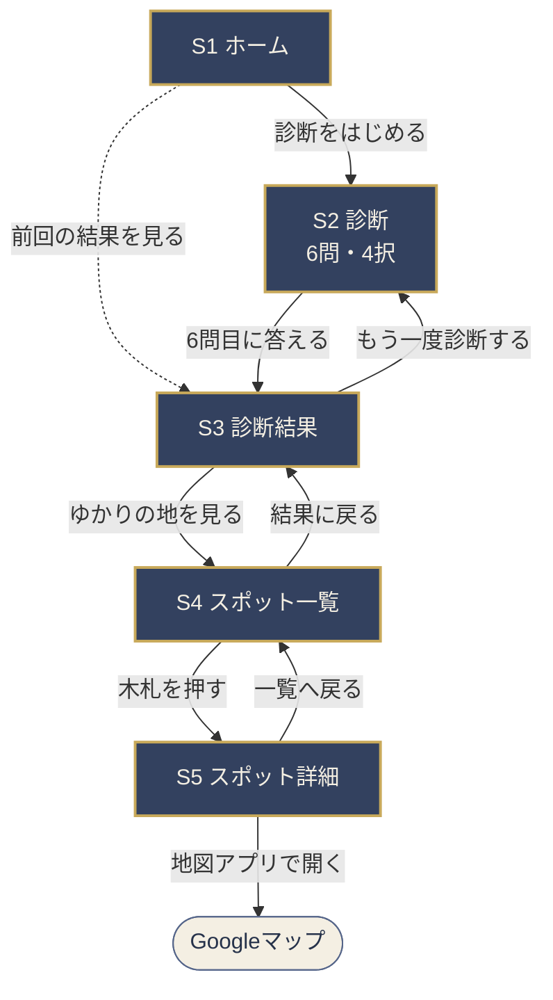
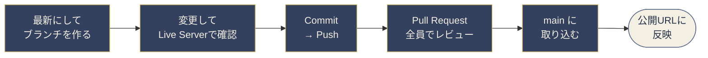

<div align="center">

# 🏯 富樫氏 史跡めぐり

**6つの質問で、あなたに合う野々市の史跡が見つかる。**<br>
加賀の守護・富樫氏ゆかりの地をめぐる、スマートフォン向けWebアプリ

[](https://yuki566.github.io/togashi-app/)


[](LICENSE)

プロジェクトデザイン実践　チーム番号：CCCA-404-5 / E5

</div>

---

## 目次

- [📱 どんなアプリ？](#-どんなアプリ)
- [🧭 使い方](#-使い方)
- [🗺️ 画面の流れ](#️-画面の流れ)
- [🧮 診断のしくみ](#-診断のしくみ)
- [🔒 プライバシーと位置情報](#-プライバシーと位置情報)
- [✅ 進み具合](#-進み具合)
- [💻 手元で動かす](#-手元で動かす)
- [📂 フォルダ構成](#-フォルダ構成)
- [🛠️ 使っている技術](#️-使っている技術)
- [👥 チームとスケジュール](#-チームとスケジュール)
- [🤝 開発の進め方](#-開発の進め方)
- [📏 授業のルール](#-授業のルール)
- [📚 出典・写真・ライセンス](#-出典写真ライセンス)

---

## 📱 どんなアプリ？

富樫氏と野々市市の史跡を題材にした、スマートフォン向けのWebアプリです。
6問・4択のタイプ診断で、あなたが **統治・武勇・信仰・学び** のどのタイプかを判定し、タイプに合う史跡を紹介します。

<table>
<tr>
<td align="center"></td>
<td align="center"></td>
<td align="center"></td>
<td align="center"></td>
<td align="center"></td>
</tr>
<tr>
<td align="center"><sub>S1 ホーム</sub></td>
<td align="center"><sub>S2 診断</sub></td>
<td align="center"><sub>S3 診断結果</sub></td>
<td align="center"><sub>S4 スポット一覧</sub></td>
<td align="center"><sub>S5 スポット詳細</sub></td>
</tr>
</table>

<sub>開発中の画面（2026年10月23日）。「仮」「準備中」の帯は、データが確定すると消えます。</sub>

| | できること |
|---|---|
| 🧩 **タイプ診断** | 6つの質問に答えると、4つのタイプのどれかがわかります（1〜2分） |
| ⛩️ **おすすめの史跡** | タイプに合う史跡3か所を、一覧の先頭に「おすすめ」の印つきで表示します |
| 📍 **現在地からの距離** | 位置情報を許可すると、各史跡までの距離と徒歩時間を表示します |
| 🗺️ **地図アプリで開く** | 史跡の詳細画面から、Googleマップでその場所を開けます |

| 画面 | 内容 |
|---|---|
| S1 ホーム | 「診断をはじめる」ボタン。前回の結果があれば「前回の結果を見る」 |
| S2 診断 | 6問（4択）を1問ずつ表示。「戻る」で前の質問へ |
| S3 診断結果 | タイプ名・説明・おすすめスポット3か所 |
| S4 スポット一覧 | 8か所を表示。位置情報を許可すると距離・徒歩時間も表示 |
| S5 スポット詳細 | 写真・解説・出典・住所・地図アプリへのリンク |

追加機能（必須機能の完成後）：スタンプ獲得、スタンプ帳、結果カード

---

## 🧭 使い方

<table>
<tr>
<td width="180" align="center">
<br>
<sub>スマホで読み取って開く</sub>
</td>
<td>

1. スマートフォンで **https://yuki566.github.io/togashi-app/** を開きます
2. 「診断をはじめる」を押して、6つの質問に答えます
3. 結果画面で、あなたのタイプとおすすめの史跡を確認します
4. 「ゆかりの地を見る」で、史跡の一覧を開きます
5. 史跡の木札を押すと、写真や解説が見られます。「地図アプリで開く」で道案内もできます

</td>
</tr>
</table>

> [!TIP]
> インストールやアカウント登録はいりません。ブラウザで開くだけで使えます。

---

## 🗺️ 画面の流れ



- S2〜S5 には「ホームに戻る」ボタンもあります（図では省略）。診断の途中で戻るときは、確認のメッセージが出ます
- 「前回の結果を見る」は、前に診断したことがあるときだけ表示されます
- 画面の切り替えは `js/app.js` の `showScreen("画面名")` で行います。ページは1枚（`index.html`）のままで、中身だけを入れ替えています

---

## 🧮 診断のしくみ

計算は [`js/diagnosis.js`](js/diagnosis.js) の `diagnose()` が行います。

1. 選択肢は、それぞれ1つのタイプ（**統治・武勇・信仰・学び**）に対応していて、選ぶと **1点** 入ります
2. 6問の合計がいちばん多いタイプが結果になります
3. 同点のときは、**最後の問い（Q6）で選んだタイプ**を優先します（※仮のルール）
4. それでも決まらないとき（Q6で選んだタイプが同点に入っていない）は、**統治 → 武勇 → 信仰 → 学び** の順で先にあるタイプにします

| 6問の答え（Q1→Q6） | 点数 | 結果と決め手 |
|---|---|---|
| 統治・武勇・統治・学び・信仰・統治 | 統治3・武勇1・信仰1・学び1 | **統治**：いちばん多い |
| 統治・統治・武勇・学び・信仰・**武勇** | 統治2・武勇2・信仰1・学び1 | **武勇**：同点なので、Q6で選んだ武勇 |
| 統治・統治・武勇・武勇・信仰・**学び** | 統治2・武勇2・信仰1・学び1 | **統治**：Q6の学びは同点に入っていないので、並び順で先の統治 |

<details>
<summary>パソコンで診断の計算だけを試す（Node.js）</summary>

`diagnosis.js` は画面と関係なく動くので、Node.js があれば計算だけを確かめられます。

```sh
node -e "const { diagnose } = require('./js/diagnosis.js'); console.log(diagnose(['統治','統治','武勇','学び','信仰','武勇']))"
```

```
{ type: '武勇', scores: { '統治': 2, '武勇': 2, '信仰': 1, '学び': 1 } }
```

</details>

質問文は [`data/questions.json`](data/questions.json)、タイプの説明とおすすめスポットは [`data/types.json`](data/types.json) にあります。

---

## 🔒 プライバシーと位置情報

このアプリは、**名前・メールアドレスなどの個人情報を集めません**。ログイン、入力欄、サーバー、アクセス解析、広告、Cookie はありません。

| 情報 | 扱い |
|---|---|
| 診断結果（タイプ名だけ。例：「統治」） | **このスマホのブラウザの中だけ**に保存します（`localStorage`、キーは `togashi-app:result`）。サーバーには送りません |
| 6問の答え | 保存しません。結果を出したら捨てます |
| 現在地 | 「現在地から距離を表示」を**押したときだけ**取得します。距離の計算に使うだけで、保存も送信もしません |

- **位置情報の許可**：ボタンを押すと、ブラウザが許可を求めます。許可しなくても、距離が出ないだけで、一覧も詳細もすべて使えます
- **外部とのやりとり**：アプリのファイルは GitHub Pages から配信されます。「地図アプリで開く」を押したときだけ、Googleマップにスポットの場所（あなたの現在地ではありません）を渡して開きます。それ以外の外部サービスは使っていません
- **データの消し方**：ブラウザの設定で、このサイトのデータ（閲覧履歴・サイトデータ）を削除すると、保存した診断結果も消えます

> [!NOTE]
> 距離の計算（`calcDistance`）は準備中です。今は現在地を取得すると「距離の計算は準備中です」と表示されます。

---

## ✅ 進み具合

2026年10月23日 時点。機能やデータを変える Pull Request では、ここも一緒に更新します。

**必須機能**

- [x] S1 ホーム（前回の結果を見る）
- [x] S2 診断（戻る・ホームに戻る・進み具合のバー）
- [x] S3 診断結果
- [x] S4 スポット一覧（おすすめを先頭に、朱印つきで表示）
- [x] S5 スポット詳細（地図アプリで開く）
- [x] 診断の計算（`diagnosis.js`）
- [x] 和風シック版のデザイン
- [x] GitHub Pages での公開
- [x] 現在地の取得（ボタンを押したときだけ）
- [ ] 距離・徒歩時間の計算（`calcDistance`）

**データ**（仮の間は、画面に「仮」「準備中」の帯が出ます）

- [ ] 質問文の確定（`questions.json`）
- [ ] タイプの説明文の確定（`types.json`）
- [ ] スポット8か所の住所・緯度経度・解説・出典（`spots.json`）
- [ ] スポットの写真撮影（`images/`）

**追加機能**（必須機能の完成後）

- [ ] スタンプ獲得
- [ ] スタンプ帳
- [ ] 結果カード

---

## 💻 手元で動かす

開発するときは、自分のパソコンでアプリを動かして確認します。

### VS Code の「Live Server」で開く（おすすめ）

1. [VS Code](https://code.visualstudio.com/) に、拡張機能 **Live Server** を入れます
2. VS Code で、このフォルダ（`togashi-app`）を開きます
3. `index.html` を右クリックして **「Open with Live Server」** を選びます
4. ブラウザが開いて、アプリが表示されます。ファイルを保存すると、自動で画面が更新されます

<details>
<summary>Live Server が使えないとき（Python で開く）</summary>

このフォルダでターミナルを開き、次のコマンドを実行します。

```sh
python -m http.server 8000
```

ブラウザで http://localhost:8000/ を開きます。終わるときは、ターミナルで `Ctrl + C` を押します。

</details>

### 困ったとき

| 症状 | 原因と直し方 |
|---|---|
| 「データを読み込めませんでした」と出る | `index.html` をダブルクリックで直接開いています。上の **Live Server** で開いてください（ブラウザの決まりで、直接開くと `data/` のJSONを読み込めません） |
| 「データを読み込めませんでした」の下に `JSON` や `Unexpected token` と出る | `data/` のJSONの書き方が間違っています。最後の項目の後ろに余計な `,` がないか、`"` が全角になっていないかを確認してください |
| 「現在地から距離を表示」を押しても位置がとれない | 位置情報は **HTTPS** か **localhost** でしか使えません。スマホから `http://192.168.…` で開いたときは使えないので、公開URLで確認してください |
| 直したのに画面が変わらない | ブラウザが古いファイルを覚えています。`Ctrl + Shift + R`（Mac は `Cmd + Shift + R`）で再読み込みしてください |

---

## 📂 フォルダ構成

```
togashi-app/
├── index.html              画面の土台（#app という枠だけがある）
├── css/
│   └── style.css           見た目（色は一番上の :root にまとめてある）
├── js/
│   ├── data.js             data/ のJSONを読み込む
│   ├── storage.js          診断結果をスマホの中に保存する
│   ├── diagnosis.js        6問の答えからタイプを決める（アプリの「頭脳」）
│   ├── screens/
│   │   ├── home.js         S1 ホーム
│   │   ├── quiz.js         S2 診断
│   │   ├── result.js       S3 診断結果
│   │   ├── spots.js        S4 スポット一覧
│   │   └── spot-detail.js  S5 スポット詳細
│   └── app.js              画面の切り替え役（最後に読み込む）
├── data/
│   ├── README.md           ★ JSONの書き方（データを直す人は最初に読む）
│   ├── questions.json      診断の質問（6問・各4択）
│   ├── types.json          4タイプの説明とおすすめスポット
│   └── spots.json          スポット8か所の情報
├── images/                 自分たちで撮影した写真
├── docs/
│   └── screenshots/        README 用の画面の写真
├── .github/
│   └── pull_request_template.md   Pull Request の説明欄のひな形
└── LICENSE                 ライセンス（プログラムは MIT）
```

> [!TIP]
> 質問・タイプ・スポットの文章を直すときは、プログラムではなく `data/` のJSONを直します。書き方は **[data/README.md](data/README.md)** にまとめてあります。

> [!NOTE]
> `index.html` の `<script>` は、**上から順番に**読み込まれます。下のファイルほど上のファイルの関数を使うので、順番を入れ替えないでください。新しい画面を作るときは、`js/screens/` にファイルを足し、`index.html` と `js/app.js` の `SCREENS` に1行ずつ足します。

---

## 🛠️ 使っている技術

<p>

</p>

| 技術 | 使い道 |
|---|---|
| **HTML / CSS / JavaScript** | アプリのすべて。フレームワークもビルドも使わず、ブラウザがそのまま読めるファイルだけで作っています |
| **JSON** | 質問・タイプ・スポットのデータ（`data/` フォルダ）。プログラムを触らずに文章を直せます |
| **localStorage** | 前回の診断結果を、スマホの中にだけ保存します |
| **Geolocation API** | 「現在地から距離を表示」を押したときだけ、現在地を取得します |
| **GitHub Pages** | アプリの公開（HTTPS）。`main` ブランチの内容がそのまま公開されます |
| **VS Code + Live Server** | 開発と動作確認 |
| **Git / GitHub / GitHub Desktop** | 変更の記録と、Pull Request でのレビュー |
| **Notion** | 議事録、AIが書いたコードのレビューログ、開発環境の準備手順 |

**あえて使っていないもの**：フレームワーク（React など）、ビルドツール、サーバー、データベース、ログイン、外部のライブラリ。
チーム全員がプログラミング未経験なので、「ファイルを開けば全部読める」ことを優先しています。

---

## 👥 チームとスケジュール

5人のチームです。プライバシー保護のため、名前は載せず、担当だけを書いています。

| 担当 | 役割 | 主なファイル |
|---|---|---|
| **A** | メンバー間の連携・進行管理 | ― |
| **B** | S1 ホーム・S2 診断・S3 診断結果 | `js/screens/home.js` `quiz.js` `result.js` |
| **C** | S4 スポット一覧・S5 スポット詳細、写真撮影 | `js/screens/spots.js` `spot-detail.js` `images/` |
| **D** | 質問・タイプ・スポットのデータの中身 | `data/*.json` |
| **E** | 診断の計算、距離の計算 | `js/diagnosis.js` |

| 時期 | 予定 |
|---|---|
| 第7〜8週 | 中間発表 |
| 第15週 | 最終発表 |

---

## 🤝 開発の進め方

環境の準備は、Notionの「開発環境の準備」ページを見てください。



### GitHub Desktop での手順

1. **最新にする**：`Fetch origin` を押し、`Pull origin` が出たら押します（ほかの人の変更を先に取り込みます）
2. **ブランチを作る**：`Current branch` →（Branch に `main` を選んで）→ `New branch`。名前は下のルールで付けます
3. **変更する**：VS Code でファイルを直し、Live Server で画面を確認します
4. **コミットする**：左下の Summary に「何をしたか」を日本語で書き、`Commit to ブランチ名` を押します
5. **Push する**：`Push origin` を押します（`main` には Push しません）
6. **Pull Request を作る**：`Create Pull Request` を押すと、ブラウザが開きます。説明欄のチェックリストを埋めて作成します
7. **レビュー**：全員で確認し、問題なければ `main` に取り込みます（Merge）。`main` に入ると、数分で公開URLに反映されます

### ブランチ名のルール

`main` には直接変更しません。1つの変更につき、1つのブランチ・1つの Pull Request にします。

| 始まり | 使うとき | 例 |
|---|---|---|
| `feature/` | 機能を作る・変える | `feature/stamp` |
| `fix/` | 不具合を直す | `fix/back-button` |
| `data/` | JSONの中身や写真を足す・直す | `data/spot-01` |
| `docs/` | README などの説明文 | `docs/readme-setup` |

### Pull Request のチェックリスト

Pull Request を作ると、説明欄に次の確認項目が自動で入ります（[`.github/pull_request_template.md`](.github/pull_request_template.md)）。

- [ ] Live Server で、変えた画面を確認した
- [ ] スマホの幅でも確認した（ブラウザの開発者ツール `F12` → スマホのアイコン）
- [ ] 生成AIが書いたコードがあれば、Notion のレビューログに記録した
- [ ] 機能・データ・ファイル構成を変えたら、README も直した
- [ ] 写真や文章に、他人の個人情報や、出典のない史実が入っていない

### コミットに本名や大学のメールアドレスを出さない設定

コミットには「名前」と「メールアドレス」が記録され、このリポジトリを見る人なら誰でも見られます。**最初に一度だけ**、次の設定をしてください。

1. GitHub の **Settings → Emails** で **Keep my email addresses private** にチェックを入れ、表示される `数字+ユーザー名@users.noreply.github.com` をコピーします
2. 同じ画面の **Block command line pushes that expose my email** にもチェックを入れます
3. GitHub Desktop の **File → Options → Git** で、Name を GitHub のユーザー名に、Email を 1 でコピーしたアドレスにします

> [!NOTE]
> この設定は、これから作るコミットにだけ効きます。

### README の画面の写真を撮り直す

画面の見た目を大きく変えたら、[`docs/screenshots/`](docs/screenshots/) の写真も撮り直します。

1. Live Server でアプリを開き、`F12` → スマホのアイコンを押して、幅 **390 × 高さ 844** にします
2. 開発者ツールの右上の `⋮` →「スクリーンショットをキャプチャ」で保存します
3. 同じファイル名（`s1-home.png` など）で上書きします

---

## 📏 授業のルール

- 生成AIが作ったコードは、実行前に全員でレビューし、担当教員に報告します（記録はNotionのレビューログ）
- 生成AIで作った画像・動画は、アプリにもポスターにも使いません
- 写真は自分たちで撮影したものを使います
- 史実は出典のあることだけを書き、創作しません

---

## 📚 出典・写真・ライセンス

### 出典

各スポットの解説の出典は、アプリの詳細画面（S5）の「出典」と、[`data/spots.json`](data/spots.json) の `source` に書いています（書き方は [data/README.md](data/README.md#出典の書き方)）。
参考にした資料の一覧は、スポットの情報が確定したらここに載せます。

### 写真

アプリに載せる写真は、チームのメンバーが撮影したものだけを使います。生成AIで作った画像や、ネットから保存した画像は使いません。

### ライセンス

| 対象 | 扱い |
|---|---|
| プログラム（HTML・CSS・JavaScript） | [MIT License](LICENSE)。自由に使えます |
| 写真（`images/`） | © 2026 チームE5。**無断転載・転用を禁止します** |
| 文章（`data/` の質問・説明・解説） | © 2026 チームE5。出典として挙げた資料の著作権は、それぞれの著作者にあります |

README のアイコンとバッジは [Shields.io](https://shields.io/) と [Skill Icons](https://skillicons.dev/)、QRコードは [QR Code Generator（goQR.me）](https://goqr.me/api/) で表示しています。各ロゴの商標は、それぞれの権利者に帰属します。
